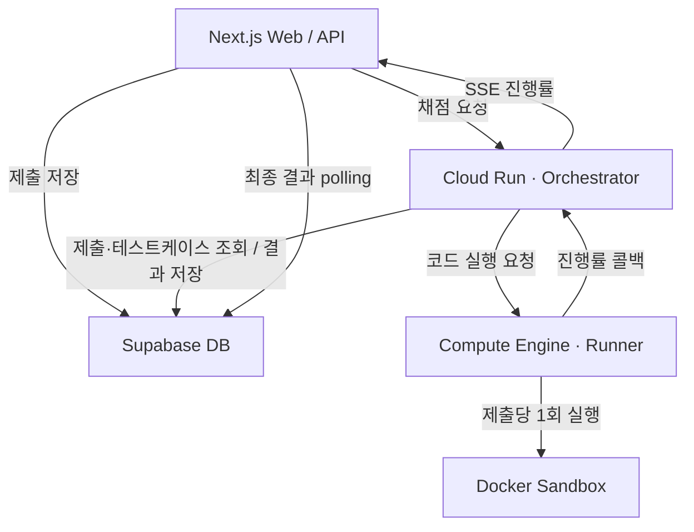

# SSOJ · 온라인 저지 채점 서버

사용자가 제출한 C++·Java·Python 코드를 Docker 컨테이너에서 실행하고, 채점 진행률과 최종 결과를 전달하는 서비스입니다.

이 저장소는 **Spring Boot 기반 채점 요청 처리 서버(Orchestrator)와 코드 실행 서버(Runner)**를 관리합니다.

## 개발 기능

- **채점 요청 처리:** 제출 ID로 코드와 테스트케이스를 조회하고 Runner에 실행 요청
- **사용자 코드 실행:** Docker 컨테이너에서 C++·Java·Python 컴파일 및 실행
- **결과 판정:** 정답 여부, 컴파일 오류, 실행 오류, 시간·메모리 초과 처리
- **진행률 전달:** Runner의 진행 상황을 받아 SSE 이벤트로 전달
- **결과 저장:** 최종 판정과 실행 시간·메모리 사용량을 Supabase DB에 저장

## 채점 성능 개선

### 문제

Python 제출의 전체 채점 시간이 약 44초까지 늘어났습니다. 개별 테스트케이스의 실행 지표와 전체 채점 시간에 차이가 있어 Runner 로그를 확인했고, 테스트케이스마다 컨테이너 생성·실행·삭제가 반복되는 것을 확인했습니다.

### 변경

- 한 제출의 테스트케이스를 하나의 Runner 요청으로 전달
- 제출당 컨테이너를 한 번 실행하고, 내부 스크립트로 테스트케이스를 순차 처리
- C++·Java는 제출당 한 번 컴파일하고, 각 테스트케이스는 새 프로세스로 실행
- 오답이나 실행 제한 초과가 발생하면 남은 테스트케이스 실행 중단

### 결과

| 항목 | 개선 전 | 개선 후 |
|---|---|---|
| 컨테이너 실행 단위 | 테스트케이스마다 생성·삭제 | 제출당 1회 |
| Python 전체 채점 시간 | 약 44초 | 약 13초 |

기존 Python 측정 기록에서 전체 채점 시간이 약 70% 감소했습니다. 포트폴리오에는 테스트케이스 100개 기준으로 기록되어 있으며, 현재 커밋의 반복 벤치마크 결과는 아닙니다.

[병목 분석·측정 조건·구현 근거](docs/judging-performance-and-reference.md#채점-성능-개선) · [Batch 실행 코드](src/main/java/com/example/ssoj/judge/executor/DockerProcessExecutor.java)

## 서비스 구조

| 구성 요소 | 담당 기능 |
|---|---|
| Next.js | 제출 접수, 채점 요청, 진행률·결과 표시 |
| Orchestrator | 제출 조회, Runner 호출, SSE 전달, 최종 결과 저장 |
| Runner | 제출별 작업 공간 준비, Docker 실행, 진행률 콜백 |
| Docker Sandbox | 사용자 코드 컴파일·실행 |
| Supabase DB | 문제·테스트케이스·제출·최종 결과 저장 |

## 실행 및 결과 처리

- 채점 요청: `POST /internal/judge-executions` — `submissionId` 전달, `202 Accepted` 응답
- 진행률 구독: `GET /api/submissions/{submissionId}/events`
- 최종 판정: `AC`, `WA`, `CE`, `RE`, `TLE`, `MLE`, `SYSTEM_ERROR`
- DB의 `execution_time_ms`는 실행한 테스트케이스 중 최대 실행 시간
- 프론트는 SSE로 진행률을 표시하고 DB polling으로 최종 결과를 확인

## 현재 구현 범위

- SSE hub는 메모리 기반이며, 여러 Orchestrator 인스턴스 간 이벤트 공유는 별도 구성이 필요합니다.
- Warm Container Pool 클래스는 구현되어 있지만 현재 Batch 실행 경로에는 연결되어 있지 않습니다.
- Java·Python 프로세스는 테스트케이스마다 새로 시작합니다.

## 문서

| 문서 | 내용 |
|---|---|
| [채점 상세](docs/judging-performance-and-reference.md) | 성능 개선 근거, API 예시, 결과 저장 모델, 구현 범위 |
| [Architecture](docs/architecture.md) | 서비스 구조 |
| [Local Development](docs/local-development.md) | 로컬 실행 방법 |
| [Deployment](docs/deployment.md) | 배포 구성 |
| [Judging Model](docs/judging-model.md) | 채점 모델 |
| [Validation Checklist](docs/validation-checklist.md) | 검증 항목 |
